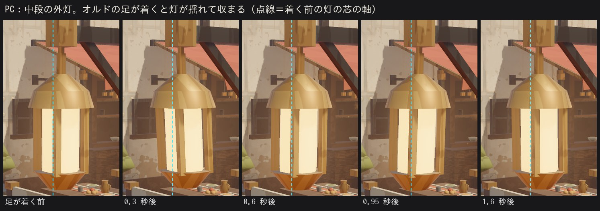
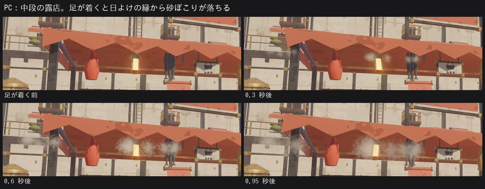
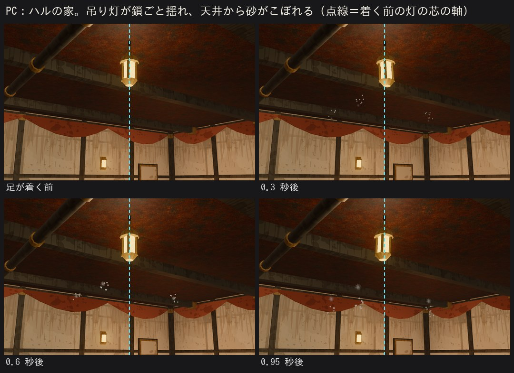
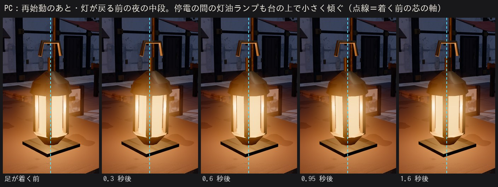
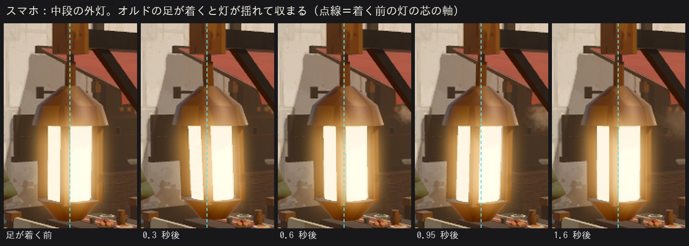
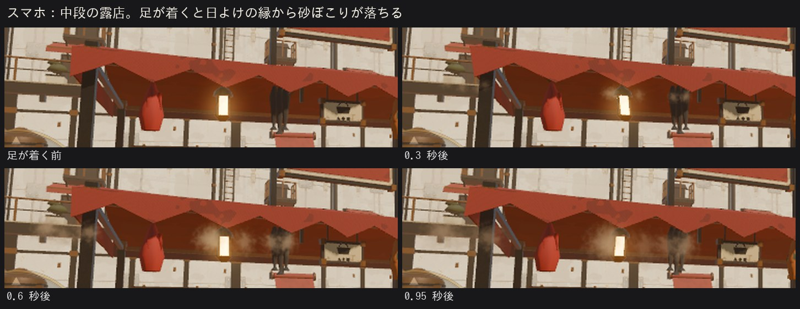

# レベルデザイン設計

> 地形の寸法ルール、遺跡・フィールド・町の作り方の原則、そして**第1章（本気ステージの範囲）の詳細な設計**を定める。
> 移動の数値は `20_ゲームシステム設計.md` の「4. プレイヤーの移動」に対応している。

---

## 1. 寸法のルール

### 1.1 基準
| 項目 | 値 |
|------|-----|
| プレイヤーの当たり判定 | カプセル型。半径 0.35m、高さ 1.55m |
| 地形の格子 | 1m。部品（キット）は 2m 単位で作る |
| 壁の部品の標準 | 幅 2m × 高さ 4m |
| 扉 | 幅 2.5m × 高さ 3.5m |
| 通路の幅 | 4m 以上（カメラが壁にめり込まないため） |
| 天井の高さ | 通路 4.5m 以上、戦闘する部屋 7m 以上 |
| 戦闘する部屋の広さ | 18m × 18m 以上 |
| 階段の段差 | 0.3m（自動で乗り越えられる 0.35m 以下） |

### 1.2 跳べる距離（設計に使う値）
| 動作 | 安全に越えられる | 限界 |
|------|----------------|------|
| 通常ジャンプの溝（同じ高さ） | 4.5m | 5.8m |
| ダッシュジャンプの溝 | 7.0m | 8.3m |
| ダッシュジャンプ＋エアダッシュの溝 | 9.5m | 10.5m |
| 通常ジャンプで登れる段 | 1.8m | 2.1m |
| 二段ジャンプで登れる段 | 3.2m | 3.6m |

- 「安全」の値を標準にする。「限界」は隠し要素や上級者向けの近道に限って使う。
- 落下ダメージはない。奈落や深い水に落ちると、直前の足場に戻る（小ダメージ）。

### 1.3 見てわかる印（読みやすさ）
色や形の具体的な表現はアートバイブルで決める。ここでは「何を見分けられるようにするか」を定める。

| 対象 | 見分け方 |
|------|---------|
| 調べられる物（宝箱、スイッチ、扉） | アクセントカラーの光 |
| 壊せる壁・岩 | 特有のひび割れ模様。武器ごとに模様を変える |
| 登れる段の縁 | 縁に細い明るい線 |
| 危険な床（熱・電気） | 色と明滅、専用の効果音 |
| セーブビーコン | 遠くからでも見える光の柱 |

---

## 2. 構成の原則

### 2.1 ノード遺跡（各章のメインダンジョン）
| 項目 | ルール |
|------|--------|
| 規模 | 12〜20 部屋、3〜5 階層 |
| 回遊性 | 各階層に少なくとも 1 つの輪になった経路を作る（行き止まりの一本道にしない） |
| セーブビーコン | 約 15 分おき。ボス部屋の手前に必ず 1 つ |
| 近道 | 中間地点とボス撃破後に、入口へ戻る近道を開ける |
| 封印庫 | アーマーの封印庫を 1 つ（試練つき） |
| 後の章の鍵 | 後で手に入る力がないと入れない場所を 2〜4 か所 |
| 行き止まり | 行き止まりには必ず何か（宝箱、遺物、ログ）を置く |
| 目印 | 部屋ごとに記憶に残る目印（巨大な歯車、割れた天井の光など）を 1 つ |

**緩急の流れ**（どの遺跡も同じ型で組む）
1. **導入**：その地域の仕掛けを、敵のいない場所で見せる
2. **学習**：仕掛けを使う簡単な謎解き
3. **応用**：仕掛けと戦闘を組み合わせる
4. **休憩**：戦闘のない探索の部屋、セーブビーコン
5. **総仕上げ**：仕掛けと戦闘の複合、中ボスまたは強敵の群れ
6. **ボス**

### 2.2 地上フィールド
| 項目 | ルール |
|------|--------|
| 広さ | 250〜400m 四方の半開放エリア |
| 着地点 | 昇降リフトの着地点から、ノードの目印が必ず見える |
| 見どころ | 3〜5 か所（小さな遺跡 2 つ、素材の採れる場所、景色のよい場所） |
| 賞金首 | 縄張りを持って徘徊する |
| 地域の危険 | 地域ごとに 1 種類（砂嵐、塩の照り返し、落石など） |

### 2.3 町（オルド背町）
- 町の配置は全章を通して基本的に変わらない。章ごとに住人、会話、店の品ぞろえが変わる。
- 第5章の襲撃で一部が壊れ、町の発展で再建・拡張される。
- 昼と夜がある（ハルの家で休むと切り替わる）。夜だけ話せる住人や、夜だけ起きるイベントがある。

---

## 3. 地形の作り方

- 地域ごとに**部品キット**（床、壁、柱、階段、通路、手すり、配管、扉など）を作り、組み合わせて部屋を作る。
- 部屋の形と部品の配置は、Blender のスクリプトで組み立てる（→ `40_技術設計.md`）。
- 敵、宝箱、イベントの位置などの**ゲームの配置情報**はデータファイルに書き、地形のファイルに置いた目印（名前つきの位置）を参照する。地形と配置を別々に直せるようにするため。
- **入口の目印**（出口の行き先。ハルが部屋に入って立つ位置と向き）は、その部屋へ入ってきた扉のすぐ内側（遺構の部屋では戻る出口から 5m 以内）に置き、戻る出口に背を向けて部屋の奥を向ける。左スティックを倒したまま出口を通ると、ハルは目印の向きへそのまま進む（20_ゲームシステム設計.md 3 章）ので、出口や壁の方を向けると、すぐ扉へ戻ったり壁に突き当たったりする（2026-10-08、隠し部屋 [14] と近道 [17] を直した）。自動テスト：`test_arrive_through_every_exit`（`test_ch1.gd`。第 1 章の出口を全部、倒したまま通る）。
- 照明は Blender で焼き込み（ライトマップ）、動く光だけをゲーム中に計算する（アートバイブル確定後に最終判断）。

---

## 4. 第1章の詳細設計（本気ステージの範囲）

### 4.1 全体の流れと時間配分

| # | 区間 | 場所 | 内容 | 目安 |
|---|------|------|------|------|
| 1 | オープニング | オルドの遠景 | 巡礼機オルドが夜明けの砂漠を歩く。黒から明けると、砂丘の低い所から町を背負って歩くオルドの全体 → 背の高さから回り込み（背の町と灯、脚の歩き）→ 砂に立つ低いカメラの前で足が着く（砂ぼこりと地響き）→ 胴の外から縁を越えて町の段々の上へ → 船首の頭の台のハルの後ろへ降りて、ハルのひと言。語り 3 行は画面の下の字幕。足音と風。長押しで飛ばせる（2026-10-20） | 1 分（約 58 秒＋ひと言） |
| 2 | 見習いの仕事 | 訓練場 | 番機の残骸の片付け。移動・ジャンプ・射撃のチュートリアル | 5 分 |
| 3 | ニコの救出 | 禁足扉 → 外殻層の入口 | 初めての戦闘（小さな番機） | 4 分 |
| 4 | 昼の町 | 町 | 持ち場を離れた説教、ヤーナのツケ | 3 分 |
| 5 | 停止 | 町 | その夜、オルドが止まる。家で眠ったハルから外の夜へ：町の灯を背に歩くオルド → 動力が切れ、振り出していた足が落ちて着き、砂ぼこりと重い地響き、強まる揺れ、体が沈む → 背の町の灯がちらついて順に消える → 家で目覚める（揺れ・「ゴゴゴ……」・会話）。外の夜は約 15 秒。長押しで飛ばせる（2026-10-20） | 2 分 |
| 6 | 夜の町 | 町 | 自由行動、禁足扉でヤーナから父の銃を受け取る | 8 分 |
| 7 | 外殻層 | 遺構 B1 | 移動の復習、崩落 | 8 分 |
| 8 | 配管層 | 遺構 B2 | 追跡、フレームとの適合、戦闘の基本 | 15 分 |
| 9 | 駆動層 | 遺構 B3 | 動力を流す仕掛け、浮遊型 | 18 分 |
| 10 | 心臓部前室・ボス | 遺構 B4 | 診断、ボス「閂」 | 10 分 |
| 11 | 再始動 | 炉心 | オルドが再び歩き出す。ナゴミが初めてノードの記憶を取り込む | 3 分 |
| 12 | 翌朝の町 | 町 | 降下許可、最初の特殊武器の開発、サブ依頼 2 件 | 10 分 |
| 13 | 再訪 | 遺構 B3 | ドリルで隠し部屋を開ける（任意） | 5 分 |
| 14 | 章末 | 演出 | カランの影、黎明機構の飛行艇 | 1 分 |
| | | | **合計** | **約 90 分** |

### 4.2 巡礼機オルドの寸法
形のデザインは Codex に発注する（`docs/art_orders/`）。レベル設計の前提となる寸法だけ定める。

| 項目 | 値 |
|------|-----|
| 全長 | 約 400m |
| 背中までの高さ | 約 120m |
| 胴の厚み | 約 50m（背中から船底まで。体内の遺跡 4 階層が入る深さ。2026-10-16 に決定：絵の比率の高さ約 70m では胴が約 30m しかなく入らないため、高さは 120m のまま） |
| 背中の町の広さ | 約 180m × 90m（遊べる範囲は約 120m × 70m） |
| 歩く速さ | ゆっくり（1 歩に数十秒）。町の中では歩行の揺れを周期的な振動と音で感じさせる |
| 体内の遺跡 | 背中の直下（外殻層）から、胴体の中心（心臓部）まで 4 階層 |

#### 4.2.1 町で感じる歩み（作ったもの、2026-11-01〜02）

上の表の「町の中では歩行の揺れを周期的な振動と音で感じさせる」を作った（`godot/scripts/view/ordo_steps.gd` の OrdoSteps、
設定は `godot/content/ordo_steps.json`）。見た目と音だけで、ゲームの中身（GameSim）は読むだけ。停止の夜にハルが言う
「揺れてない。いつもの足音がしない。」と、再始動の「止まっていた足音が、ゆっくりと、また始まった」が、遊んでいる間に聞いていた音を指すようになる。

- **リズム**：オルドの足は 2 本ずつ（右と左で 1 本ずつ）、20 秒ごとに砂に着く（1 周 80 秒、OrdoView と同じ決まり。組は 左 2・右 1 → 左 4・右 3 → 左 1・右 2 → 左 3・右 4）。
  町のどの部屋でも、その時刻に 1 回ずつ鳴って揺れる。時計は部屋を移っても続く：オルドのいる部屋（オープニング・下段・中段）ではそのオルドの
  足が着いた知らせで鳴らし（見える脚と音がそろう）、部屋を作るときにそのオルドへ今の時計の位置を渡す。オルドのいない部屋（家の中・上段・
  訓練場・遺構）は、同じ時計をゲームの刻み（1/60 秒の和。描画の速さに関係しない）で進める。新しいゲーム・ロードではプレイ時間から始める。
- **止まる・また歩く**：停止の場面の「動力が切れる」合図（`fx: ordo_stop`）から、停止の夜（`ch1.ordo_stopped`）を経て再始動（`ch1.ordo_restarted`）までは
  何も鳴らない・揺れない（町の電気が切れている間と同じ区切り。電気の見た目は TownPower、42 章 14.8）。再始動の刻みに部屋にいれば
  0.4 秒後（`restart_first_s`）に重い最初の 1 歩（3 dB 大きく、低く、揺れも 1.6 倍、天井からこぼれる砂も 2 倍）、そのあとはいつもの 20 秒ごと。
  - 第 1 章の再始動は炉心（遺構 B4 の r20）。再始動のフラグは、語りの最後の行「巨大な足が、地を踏みしめる。止まっていた足音が、ゆっくりと、また始まった。」
    の直前に立つ（その行だけを会話 `ch1.restart.c` に分けた。前の 2 行は `ch1.restart.b`）。重い 1 歩はその行の文字が出始めてすぐ（0.4 秒で「巨大な足が、
    地を踏みしめる。」の 14 文字が出たところ）、遺構の重い音で鳴る（2026-11-02 まではフラグから 2.5 秒で、読む人はまだ 1 行目の途中だった）。町の灯が戻る波（歓声 `ch1.cheer` の始めの `fx: town_power_on`。原点から約 4 秒で町じゅうへ）は、そのあとのノードの記憶の話と
    中段への移動のあとなので、重い 1 歩とは重ならない。第 1 章の見本の通し（`--ch1_full --steps_log`。会話を 0.1 秒ごとに送るので、遊ぶときより
    ずっと詰まっている）でも、停止の合図から再始動まで無音、炉心の重い 1 歩のあと数秒して中段で灯が戻る波、次の足は重い 1 歩から 20 秒後と、
    順に分かれている（2026-11-02）。
  - 歓声の波の途中で（時計どおりに）足が着いたら、波が終わるまで待たせてから鳴らす（灯が戻る → いつもの揺れ、の順にして、灯のちらつきと
    灯の揺れを重ねない。足は 20 秒ごとなので 5 回に 1 回くらい。待つのは最大 4 秒ほどで、次の足は時計どおり）。
  - 再始動のあと・歓声の前の暗い中段（電気は町の外で戻ったが、まだ見せていない）でも足音は戻っていて、停電の間だけの灯油ランプも揺れる。
- **場所ごとの音**（効果音の音量からの差。近い脚の組ほど大きい：脚の付け根までの距離で 100 m なら基準、範囲の中で上下。毎回 ±1 dB ばらつく。
  音のファイルにスマホ用の「ごとっ」を足して全体が約 2 dB 小さく書き出されたので、基準を 2 dB 上げた（遺構は 1 dB）。耳で聞いた値ではない）：

| 場所 | 部屋 | 音 | 基準 | 揺れ（画面の沈み・傾き／吊り物の重み 1 の幅） | ほか |
|------|------|----|------|------|------|
| 屋外 | オープニング・下段・中段・上段・訓練場 | `ordo_thud`（遠い地響き。打ち始めがやわらかく、低い音のほかは骨組みの「ごとっ」330 Hz 前後だけ） | -7 dB（-16〜-2） | 2.2 cm・0.16 度／12 cm | 日よけ・洗濯物・垂れ幕の下の端から砂が落ちる（カメラの前 25 m 以内の近い 10 か所から 5 か所、1 か所に砂粒 5〜7 と小さな砂ぼこり 2〜3・約 1.5 秒） |
| 屋内 | 家・工房・ギルド・町長の家 | `ordo_thud_in`（壁ごしにこもった地響き＋家の骨組みの小さな「ごとん」「ごとっ」） | -8 dB（-16〜-4） | 1.6 cm・0.13 度／13 cm | 7 割の足音で器・道具が小さく鳴る（`ordo_rattle`・`_2`・`_3` の 3 つの鳴り方から 1 つ、-19 dB、0.3〜0.55 秒あと）、天井から細い砂が 3 筋 |
| 遺構 | 禁足扉の前室と B1〜B4 | `ordo_thud_deep`（重い地響き＋鉄の胴の倍音でない響き 52〜241 Hz と「ごーん」360 Hz 前後＋低いうなり） | -6 dB（-13〜-1。脚に近いので 60 m で基準） | 3.0 cm・0.2 度／14 cm | 天井から細い砂が 4 筋 |

  中段の真ん中では 4 つの組とも約 -7 dB（左右・前後が対称）、上段では船首の組 -5 dB と船尾の組 -10 dB、家では -5〜-10 dB と組ごとに変わる。
  表の範囲は脚 1 本の値で、鳴らすのは組（2 本）の和なので最大 3 dB 上がる（重い 1 歩はさらに +3 dB）。見本の通しで鳴った値：ギルド -5.2 dB、
  上段 -11.5 dB、炉心の重い 1 歩 -4.8 dB。
  遺構は再始動のあとに行ける（駆動層の壁・隠し部屋・ビー玉）ので、そのときは重い音で鳴る（停止の夜の遺構は鳴らない）。
- **画面**：足が着くと、遊びのカメラが 2 cm ほど沈んでから戻り、ゆっくり横へ揺れ、わずかに傾く（4 秒で消える）。1 cm（2026-11-02 まで）では PC で 1〜2 画素、
  スマホで 0.4 画素しか動かず見えなかったので 2 倍にした。場面の揺れ（CineDirector、目で 8 cm くらい）や Fx の揺れ（着地 0.25 で 4 cm、速く震える）よりは小さい。設定の「画面の揺れ」（20 章 22 節）を掛ける。映画のような場面の間は、場面が自分で足音（`ordo_step`）を
  鳴らすので、ここは鳴らさず画面も動かさない。
- **世界の小さな反応**（部品ごとのノードは足さない。キットの材質の揺れの重み＝頂点の色のアルファを使う）：
  - 布・旗・吊り札・吊るした乾物・垂れ幕：キットの材質の `jolt`（`kit_motion.gdshaderinc`）。足が着いてから約 0.8 Hz で振り子のように揺れ、4 秒ほどで収まる
    （いちばん大きいのは 0.3 秒後で、表の幅の約 0.75 倍。重み 0.6 の外灯の灯の下の端で 5〜7 cm。2026-11-02 にコマで見えにくかったので 3 割ほど大きくした）。
    場所ごとに速さと向きを少しずらす（隣とそろわない）。速さは場所でなめらかに変える（2026-11-02 までは折り返す値 `fract` で、折り返しの線が
    x = z = 0 を通り、そこに吊った家・工房・町長の家の灯が左右で違う速さで揺れて 15 % ほど伸び縮みした）。揺れる向きは近い脚の側から押される向きに、
    前へよろめく向きを少し混ぜる
  - 壁に掛けた垂れ幕（`town/goods_cloth_wall`。中段の食堂の壁）は、すぐ前に梁があるので足音の揺れを 0.3 倍にする（`"soft"`。材質の写しに倍率
    `jolt_scale` を付けて替える。風の揺れと重みは同じ）。1 倍では 4〜5 cm 押し出されて梁の前に出た
  - 吊り灯（外灯・背の高い外灯・露店と天幕の灯・訓練場の綱の灯・リフトの踊り場の灯・家・工房・町長の家・ギルドの天井の灯）：
    部品を読むとき（`RoomKit.part_mesh`）に、灯の芯の筒の形で灯を見つけ（芯の材質は電気の灯 `amber` と油の灯 `flame` のどちらも見る）、
    吊り金具から下へ揺れの重み（屋外 0.6、屋内 0.5）を足す。家・工房・町長の家の灯は鎖ごと天井から揺らす（`"chains"`）。
    ギルドの十字の吊り灯 2 つは、鎖の真下の半径 0.8 m の筒の中（鎖・十字の腕・4 つの灯）を天井からの 1 つの振り子にする（`"chains"` の 4 つ目の値。
    灯ごとに揺らすと、止まった腕の下で 4 つの灯がばらばらに揺れた）。
    壁の平たい灯・小さく縮めた灯・炉の熾火（`flame` の細い帯）は外す
  - 置いた携行灯（`town/hand_lantern`。芯は油の灯 `flame`。停電の間だけ置く灯油ランプ `"blackout": true` も同じ部品）：台に着いた底は動かさず、
    上ほど重い重み（提げ手で 0.2、`"stand": true`）。足が着くと台の上で小さく傾いで戻る（提げ手で 2 cm ほど、重い 1 歩で 3 cm ほど）。
    風の揺れも同じ重みで入るが、提げ手で 1 cm ほど（突風のとき）。吊り灯の部品の中に置いた携行灯も同じにする（`"stands"`：リフトの踊り場
    `town/ordo_landing` の木箱の上の灯油ランプ。吊り灯の重みでは台の上で振り子のように滑った）
  - 重みを足した灯の芯の材質（`amber`・`flame`）にも、金物と同じ風の揺れを入れる（籠と一緒に動く。重みの無い芯は動かない）。
    これで芯の材質も足音の揺れ（`jolt`）を受ける材質に入る
  - 砂ぼこり・こぼれる砂：AmbientFx（落砂・蒸気と同じ所）。砂ぼこりの出る所は、`"puffs"` の部品の揺れる布（重み 0.2 以上、高さ 1.8〜4.8 m）の下の端を、
    部品を読むときに 1.2 m の升ごとに覚える（中段 94 か所、下段 28、訓練場 26、上段 11、オープニング 6）。
    布の縁から細かい砂粒が筋になって落ち、小さな砂ぼこり（0.3〜0.6 m）が下へ流れて消える（上がらない。湯気・煙に見えないように）。色は濃い砂の色
    `#a87a4e` を sRGB から直して渡す（粒の層は光を受けず、色をそのまま描く。直さないと白っぽい灰色になった）。夜は 0.45 倍、町の電気が消えている間は
    0.3 倍の明るさ。大きさは近い脚の組・重い 1 歩ほど大きく（場所の `"jolt"` の何倍の揺れか）、カメラまでの距離の 1/4 まで
  - 足音のあとに遅れて出すもの（器の音・天井の砂・砂ぼこり）は、部屋を移ったら出さない（家を出た直後に、外の通りで天井の砂が降らない）
- **軽さ**：毎刻みの仕事は、揺れている 6 秒の間だけ材質 4 つ（flat・metal・amber・flame）の値を入れるのと、カメラの位置を足すだけ。布・灯の揺れでは描画の回数は
  増えない。砂ぼこり・こぼれる砂は Vfx の今ある層（DUST・DOT）で描くので、粒が出ている 2 秒ほどだけ層ごとに 1 回増える（20 秒に 1 回）。
  灯の重みは部品を読むときに 1 回（いちばん大きい訓練場の部品で 8 ms）。
  スマホの描き方（gl_compatibility、844×390）で数えた描画の回数（足が着く前 → 粒が出ている間。2026-11-02、`--steps_shots` の「描画」）：
  中段の外灯 242 → 243、露店 277 → 278、ハルの家 40 → 42（砂の粒とかすみの 2 層）、停電の夜の中段の灯油ランプ 234 → 235。
  PC（Forward+）は 216 → 217、252 → 253、25 → 27、204 → 205。1 こまの時間は測っていない（撮影はソフトウェアの描画なので実機の目安にならない）。
- **音の数値**（`tools/audio/levels.py`。帯ごとの強さの割合 dB、全体 = 0。**まだ誰も耳で聞いていない**）：

| 音 | 長さ | 立ち上がり（10→90 %） | -20 dB まで | <40 Hz | 40–80 | 80–160 | 160–320 | 320–640 | 640–2k | 2k–8k |
|----|------|------|------|------|------|------|------|------|------|------|
| ordo_thud | 3.0 秒 | 30 ms | 0.90 秒 | -6.5 | -1.8 | -10.7 | -23.7 | -16.5 | -30.5 | -62 |
| ordo_thud_in | 2.6 秒 | 30 ms（家の「ごとん」） | 0.94 秒 | -5.5 | -2.1 | -12.3 | -14.9 | -20.9 | -38.4 | -61 |
| ordo_thud_deep | 4.0 秒 | 130 ms | 0.77 秒 | -3.5 | -3.8 | -9.5 | -20.4 | -20.2 | -35.3 | -66 |
| ordo_rattle | 0.8 秒 | 100 ms | 0.07 秒 | -58 | -57 | -51 | -35 | -11 | -31 | -0.5 |
| （比べ）ordo_step（場面） | 3.2 秒 | 40 ms | 0.92 秒 | -10.4 | -2.1 | -6.7 | -13.3 | -16.5 | -19.9 | -27 |

  町の足音は場面の足音より中・高い音がずっと少ない（耳より体で感じる音）。2026-11-02 までは 300 Hz より上がほとんど無く（全体の 0.05 % 以下）、
  スマホのスピーカー（300 Hz より下を切る 4 次のフィルターで見積もり）では町の曲の中くらいの大きさより 16〜26 dB 小さく、聞こえない見込みだった。
  そこで骨組みの「ごとっ」（250〜800 Hz の倍音でない 3 つの音と短い雑音、12 ms で丸く立ち上げる。`steps.py` の `_mid_knock`）を低い地響きの下に小さく重ねた
  （300 Hz より上は全体の 1〜2 %）。同じ見積もりで、中段の足音は町の昼の曲の中くらいの大きさより約 6 dB、ギルドの中は約 6 dB、遺構 B2 は約 5 dB 小さい
  （曲の静かな所では聞こえる大きさ。`build` の見積もりの道具で測った値）。
  長く遊んで気にならないかは、聞いて確かめる（大きさは `ordo_steps.json` の `"db"` で変えられる）。
- **コマ**（`docs/progress_shots/town_steps/`。足が着く前と、0.3・0.6・0.95・1.6 秒後。カメラは固定で、世界の揺れだけを写す。PC は 1600×900、
  スマホは描き方 gl_compatibility の 844×390 から切り抜いて拡大）：
  外灯の揺れ `pc_lamp.jpg`・`phone_lamp.jpg`、露店の日よけの砂ぼこり `pc_dust.jpg`・`phone_dust.jpg`、家の吊り灯と天井の砂 `pc_home.jpg`・`phone_home.jpg`、
  再始動のあと・灯が戻る前の夜の中段の灯油ランプ `pc_oil.jpg`・`phone_oil.jpg`、スマホの設定の画面の「画面の揺れ」の行 `phone_settings.jpg`。

  
  
  
  
  
  
- **確かめ**：`tests/test_steps.gd`（時計が OrdoView と同じ刻み・家の中で 20 秒ごと・動力が切れる合図から止まっている間は鳴らない・再始動で戻る・
  灯が戻る波の間の足は波のあとに鳴る・部屋を移っても 20 秒の倍数・脚ごとの大きさ・遺構の音・灯の重み（外灯・携行灯・停電の夜の灯油ランプ、芯の amber と flame、
  船着き場の木箱の上の灯油ランプ、ギルドの十字の吊り灯、壁の垂れ幕の弱めた揺れ）・遅れて出すものは部屋を移ったら出さない・再始動のフラグは最後の行の直前・
  砂ぼこりは落ちて上がらず、近い脚ほど大きく、夜は暗い・「画面の揺れ」がどの揺れにも掛かる）。コマ：`docs/progress_shots/town_steps/`（`--steps_shots`、`scripts/debug/steps_shots.gd`）。

### 4.3 オルド背町の配置

甲羅の曲面に沿った 3 段の段々構造。

```
          [頭側]
  +-----------------------------------------+
  |  上段:  (U1) 町長の家   (U2) ギルド       |
  |         (U3) 展望台                      |
  |-----------------------------------------|
  |  中段:  (M1) 広場 ── (M2) 市場           |
  |         (M3) ヤーナの工房  (M4) 食堂      |
  |-----------------------------------------|
  |  下段:  (L1) 住宅の段々  (L2) ハルの家    |
  |         (L3) 訓練場      (L4) 昇降リフト  |
  |         (L5) 禁足扉（背中の遺構への入口）  |
  +-----------------------------------------+
          [尾側]
```

| 記号 | 場所 | 第1章での役割 |
|------|------|-------------|
| U1 | 町長の家 | 停止後の町長トルーデとの会話 |
| U2 | 回収屋ギルド | 見習いの仕事の受付、持ち場を離れた説教、翌朝の降下許可 |
| U3 | 展望台 | 章末に地平線のカランを見る場所 |
| M1 | 広場 | 町の中心。停止時の騒ぎ、再始動時の歓声 |
| M2 | 市場 | 雑貨屋（補修パック）、ジャンク屋 |
| M3 | ヤーナの工房 | ツケの場面、翌朝の特殊武器開発 |
| M4 | 食堂 | 住人の会話（本気ステージでは外観のみでも可） |
| L1 | 住宅の段々 | 住人の会話、サブ依頼 |
| L2 | ハルの家 | セーブ、休息 |
| L3 | 訓練場 | 見習いの仕事（チュートリアル） |
| L4 | 昇降リフト | 第1章では動かない（第2章への期待を持たせる） |
| L5 | 禁足扉 | ニコの救出、ヤーナから父の銃を受け取る場面、遺構への入口 |

**本気ステージで作る範囲**：M1・M2（雑貨屋）・M3・U2・L2・L3・L5 と、それらをつなぐ道。住人は 12 人前後。

**停止の夜の見た目（停電の夜、2026-11-01）**：オルドが止まった夜（`ch1.ordo_stopped`）から再始動（`ch1.ordo_restarted`）まで、町には電気が来ない
（書き方は 42_コンテンツの書き方.md 14.8）。
- 電気の灯（街灯・露店の吊り灯・記念の柱の灯・窓の灯・屋内の天井の灯・屋内の明るい窓）は消える。家で目覚めたとき、灯がちらついて消える（揺れのあと）。
- 灯るのは油の灯だけ：人の集まる所に灯油ランプ（町長の壇の前の両端＝広場の集まり、雑貨屋の台の横、ジャンク屋・食堂の台、禁足扉の前のヤーナ、展望台の見張り、ギルドの受付）と、
  ハルの家のベッドの横の携行灯、工房の炉の火。ランプは揺らぎ、床に明るい輪を落とす。
- 道は青白い月明かりで読めるようにする（広場の床・段・扉が見え、住人の顔はランプの側から照らされる）。屋内の夜も昼の明るさにしない。
- 再始動の歓声（中段 `ch1.cheer`）の始めに、広場の下から外へ、灯がちらつきながら波のように点いていく（約 2〜3 秒。停止の灯が消える逆）。
  そのあと町長たちの会話。遺構の部屋（自分の古い灯）、昼と朝の見た目、オープニングは変えない。

### 4.4 背中の遺構

#### 階層の概要
| 階層 | 名前 | 雰囲気 | この階層で教えること |
|------|------|--------|---------------------|
| B1 | 外殻層 | 甲羅の裏側。割れ目から光が差す。ハルの遊び場 | 移動、ジャンプの高さの調整、収集 |
| B2 | 配管層 | 太い配管が走る暗い層。蒸気、非常灯 | 追われる緊張感、フレームの力（ロックオン、光刃） |
| B3 | 駆動層 | 巨大なピストンと歯車。オルドの脚を動かす機構 | 動力を流して足場を動かす仕掛け、空中の敵 |
| B4 | 心臓部 | 胴体の中心。円形の広間と炉心 | ボス戦 |

#### 部屋の構成

```
B1 外殻層
  [01]--[02]--[03]--[04]--[05]
                              |（床が崩れて落下）
B2 配管層                      v
  [06]--[07]--[08]--[09]--[10]--[11]
                                  |（縦坑を下る）
B3 駆動層                          v
  [17]==[12]--[13]--[15]--[16]
   |     :                  |
   |    [14]                |（中央縦坑のリフトで下へ）
   |                        v
   |                B4 心臓部
   |                 [18]--[19]--[20]
   +-- 近道のエレベーター（B1 の [02] へ戻れる）

  == は扉、: はひび割れた壁（ドリルが必要）
```

| # | 部屋 | 内容 | 敵 | 置く物 |
|---|------|------|----|--------|
| 01 | 禁足扉の前室 | 入口。プロローグのニコ救出もここ | 子番機 ×1（プロローグのみ） | — |
| 02 | ジャンク溜まり | ガラクタの山。収集の練習 | — | 宝箱（50 セル）、遺物 |
| 03 | 整備通路 | 1.5〜3.5m の溝を跳ぶ。ボタンを押す長さでジャンプの高さが変わることを教える | — | 高い場所に遺物 |
| 04 | 換気室 | 止まった大型ファン。詰まった弁を撃って開ける（照準の練習） | 子番機 ×2 | セル |
| 05 | 崩落床 | 床が崩れて B2 へ落ちる（イベント） | — | — |
| 06 | 落下地点 | 暗い。進む方向を非常灯で示す | — | 補修パック |
| 07 | 追跡通路 | 歩哨型 2 体に追われて逃げる。配管の隙間をくぐり抜ける。最後は行き止まり | 歩哨型 ×2（倒せない演出の区間） | — |
| 08 | 封印室 | **フレームとの適合（見せ場）**。胴の核とナゴミが目覚める。ロックオンと狙いの切り替えの練習（ナゴミが的を映し出す） | 練習用の的 | — |
| 09 | 配管広間 | 最初の本格的な戦闘。配管が遮蔽物になる | 歩哨型 ×3 → 突撃型 ×1（回避の練習） | セル |
| 10 | 弁の間 | 入口で左腕の籠手が目覚める（**光刃の解放**）。盾型の登場（光刃で盾を崩す練習）。弁の輪を撃って扉を開ける | 盾型 ×1、歩哨型 ×2 | 宝箱 |
| 11 | 縦坑 | 足場を跳び移りながら下る。底に**最初のセーブビーコン** | — | 遺物 |
| 12 | 駆動回廊 | 止まった巨大ピストン。ナゴミの案内で動力の球を撃つと、ピストンが動いて足場になる（タイミングジャンプ）。穴は深く、落ちたら 10 ダメージで直前の動かない足場（入口・出口の台）へ戻る（2026-10-14。前は底に立てて、坂が見つけにくく詰んだ）。動力がフレームにも流れ、脚のスラスターが目覚める（**ダッシュの解放**） | — | — |
| 13 | 歯車の間 | 動力が戻って回る歯車の足場。浮遊型の登場 | 浮遊型 ×3 | 宝箱 |
| 14 | 隠し部屋 | ひび割れた壁の奥。ドリルが必要（章の後半で再訪） | — | **ライフコア** |
| 15 | 伝導路 | 動くピストンの間での混戦 | 歩哨型 ×2、浮遊型 ×2、盾型 ×1 | 宝箱（**チップ「チャージ化」**） |
| 16 | 中央縦坑 | リフトで下る途中に待ち伏せ | 突撃型 ×2 | — |
| 17 | 近道 | B1 の [02] へ戻るエレベーター。内側から開ける | — | — |
| 18 | 心臓部前室 | ナゴミの診断（ノードの話）。**セーブビーコン** | — | 補修パック |
| 19 | 心臓部 | **ボス「閂」** | — | — |
| 20 | 炉心 | オルドの再始動（イベント） | — | — |

#### 部屋ごとの寸法の目安
| 種類 | 広さ | 天井 |
|------|------|------|
| 通路型（03, 07） | 幅 4〜6m × 長さ 30〜40m | 5m |
| 戦闘の部屋（09, 10, 15） | 20m × 24m | 8m |
| 縦長の部屋（11, 16） | 12m × 12m × 高さ 20〜30m | — |
| 仕掛けの部屋（12, 13） | 16m × 36m | 12m（上下の移動がある） |
| ボス部屋（19） | 直径 32m の円形 | 16m |

#### 敵の総数
歩哨型 12、突撃型 4、盾型 3、浮遊型 6、子番機 3（プロローグ含む）。
第1章は「一度に相手をするのは最大 4 体」までに抑える。

### 4.5 ボス「閂（かんぬき）」

**姿**：心臓部の扉を閉ざす、巨大な閂（扉のかんぬき）のような円筒形の番機。4 本の削岩腕を持ち、円形の部屋の外周にあるレールに沿って滑るように動く。背中に「錠前核」（弱点）を持つ。

**舞台**：直径 32m の円形の部屋。中央に閉ざされた炉心の扉。外周にレール。壊れる柱が 4 本（遮蔽物になるが、ボスの攻撃で壊れていく）。

| 段階 | HP | 行動 |
|------|-----|------|
| 第1段階 | 100〜66% | レールを滑りながら戦う。<br>・**削岩突き**：腕が回転を始める（予兆 0.8 秒）→ レールに沿って突進。壁に刺さって 2 秒止まり、背中の錠前核が露出する（反撃の好機）<br>・**回転薙ぎ**：腕を広げて回転。半径 8m。ジャンプかダッシュで避ける<br>・**破片射出**：削った破片を 5 発撃つ |
| 第2段階 | 66〜33% | レールを外れて部屋の中に降りてくる。<br>・**叩きつけ**：床に叩きつけて輪状の衝撃波（ジャンプで越える）<br>・**番機の呼び出し**：壁の穴から歩哨型 2 体を呼ぶ<br>・第1段階の攻撃も使う |
| 第3段階 | 33〜0% | 過熱して腕が赤く光る。動きが速くなる。<br>・**連続突進**：3 回続けて突進する<br>・**床の過熱**：外周の床が熱くなる（危険な床）<br>・過熱のため、錠前核が露出する回数が増える |

- HP 1,200。削岩腕は個別に壊せる（腕を壊すとその腕の攻撃がなくなる）。
- 初見の撃破時間の目安：4〜5 分。
- 戦闘中の掛け合い：閂が古代語で警告を発し、ナゴミが訳す。「『侵入者を排除します』……だそうです」。ハルが言い返す。
- 撃破後：「閂のコア」を落とす → ヤーナが「ブレイクドリル」を開発する。

### 4.6 イベントとフラグ（第1章）

| 順番 | フラグ名（仮） | 起きること |
|------|---------------|-----------|
| 1 | `ch1.chores_started` | 訓練場で見習いの仕事を始める |
| 2 | `ch1.nico_rescued` | ニコを救出（仕事は放り出したまま） |
| 3 | `ch1.scolded` | ギルドで持ち場を離れた説教 |
| 4 | `ch1.debt_scene` | 工房でツケの場面 |
| 5 | `ch1.ordo_stopped` | 夜、オルドが止まる |
| 6 | `ch1.got_spark` | 禁足扉でヤーナから父の銃を受け取る |
| 7 | `ch1.fell_to_b2` | 崩落して B2 へ |
| 8 | `ch1.frame_fitted` | フレームとの適合、ナゴミ起動 |
| 9 | `ch1.first_beacon` | 最初のセーブビーコン |
| 10 | `ch1.drive_powered` | 駆動層に動力が戻る |
| 11 | `ch1.shortcut_open` | 近道のエレベーターが開く |
| 12 | `ch1.diagnosis` | 心臓部前室での診断 |
| 13 | `ch1.boss_defeated` | 閂を撃破 |
| 14 | `ch1.ordo_restarted` | オルドが再び歩き出す |
| 15 | `ch1.descent_permit` | ギルドで降下許可を得る |
| 16 | `ch1.drill_developed` | 工房でブレイクドリルを開発 |
| 17 | `ch1.complete` | 章末の演出 |

### 4.7 第1章の報酬と収集物
| 物 | 数 | 場所 |
|----|-----|------|
| 特殊武器「ブレイクドリル」 | 1 | 閂のコアから開発 |
| ライフコア | 1 | [14] 隠し部屋（ドリルで再訪） |
| チップ「チャージ化」 | 1 | [15] の宝箱 |
| 遺物 | 5 | B1〜B3 |
| セル | 約 1,200 | 宝箱、敵、遺物の売却 |
| サブ依頼 | 2 | 翌朝の町（例：ニコの失くし物探し、雑貨屋の配達） |

---

## 5. MVP 用の仮の地形（グレーボックス）

本気ステージの前に、単純な形だけで遊びの骨格を確かめるための地形。

| 部屋 | 内容 |
|------|------|
| A：スタート | 20m × 20m。段差（1.0m、1.8m、2.4m）と溝（3m、5m、8m）を並べ、移動の数値を確かめる |
| 通路 | 幅 4m × 長さ 30m。カメラが壁に当たる挙動を確かめる |
| B：戦闘の部屋 | 24m × 24m。遮蔽物の柱。歩哨型と突撃型が出る |
| ひび割れた壁 | B の奥。ドリル（特殊武器）で壊すと小部屋に宝箱 |
| NPC | A に 1 人。会話 1 本とイベント 1 つ |
